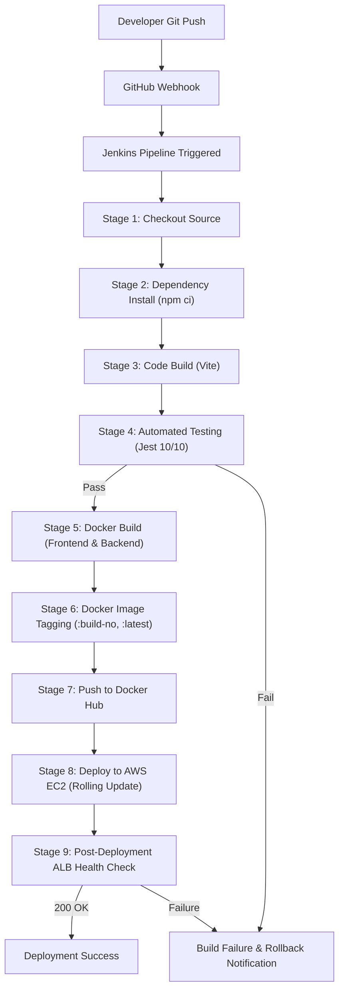

# 🚀 CloudCart – Phase 6 Documentation: CI/CD Automation & Monitoring

> **Project:** CloudCart – Cloud-Native E-Commerce Platform  
> **Phase:** 6 – CI/CD Automation and Infrastructure/Application Monitoring  
> **Technologies:** Jenkins LTS, GitHub Webhooks, Docker, Docker Hub, AWS EC2, Prometheus, Node Exporter, Grafana  
> **Environment:** Production (`ap-south-1` Mumbai)  

---

## 1. Architectural Overview

Phase 6 introduces enterprise-grade automated continuous integration/deployment and multi-dimensional observability into the existing CloudCart cloud architecture:

```text
                                  +-------------------------------------------------+
                                  |              Developer GitHub Push              |
                                  |   (https://github.com/jassika-kaur/cloudcart)   |
                                  +-------------------------------------------------+
                                                           |
                                                           | Webhook Trigger (Payload URL)
                                                           v
                                  +-------------------------------------------------+
                                  |             Jenkins CI/CD Automation            |
                                  |   - Dependency Install (npm ci)                 |
                                  |   - React Production Build (npm run build)      |
                                  |   - Automated Jest Testing (npm test)           |
                                  |   - Multi-stage Docker Image Build & Tagging    |
                                  |   - Push Images to Docker Hub (jassikakaur/*)   |
                                  |   - Rolling EC2 Deployment (AWS SSM / Docker)   |
                                  |   - Post-deployment ALB Health Verification     |
                                  +-------------------------------------------------+
                                                           |
                                                           | Rolling EC2 Deployment
                                                           v
+-----------------------------------------------------------------------------------------------------------------------+
| AWS EC2 Production Compute Tier (Auto Scaling Group across Private Subnets)                                           |
|                                                                                                                       |
|   +--------------------------+    +--------------------------+    +-----------------------------------------------+   |
|   |   Frontend Container     |    |   Backend Container      |    |              Node Exporter                    |   |
|   |   (React / Nginx :3000)  |    |   (Express REST :5000)   |    |         (EC2 Host Metrics :9100)              |   |
|   +--------------------------+    +--------------------------+    +-----------------------------------------------+   |
|                                                |                                                  |                   |
|                                                | Scrapes /metrics                                 | Scrapes :9100     |
|                                                v                                                  v                   |
|                                   +---------------------------------------------------------------+                   |
|                                   |                    Prometheus Server (:9090)                  |                   |
|                                   |                    Global Interval: 15s | Scrape: 5-10s       |                   |
|                                   +---------------------------------------------------------------+                   |
|                                                                  |                                                    |
|                                                                  | PromQL Queries & Alert Rules                       |
|                                                                  v                                                    |
|                                   +---------------------------------------------------------------+                   |
|                                   |                   Grafana Dashboard (:3001)                   |                   |
|                                   |     Auto-Provisioned 'cloudcart-overview' Dashboard           |                   |
|                                   +---------------------------------------------------------------+                   |
+-----------------------------------------------------------------------------------------------------------------------+
```

---

## 2. Complete CI/CD Workflow

The automated deployment pipeline guarantees that only syntactically sound, fully tested, and containerized code reaches production:



---

## 3. Jenkins Installation and Configuration

### A. Running Jenkins via Docker
Jenkins is run using the custom container definition located at `cloudcart/jenkins/Dockerfile` (which includes Docker CLI, AWS CLI v2, and Node.js 20 LTS):

```bash
cd cloudcart

# Start Jenkins controller in background
docker compose -f docker-compose.jenkins.yml up -d

# Retrieve initial administrator setup password
docker exec -it cloudcart-jenkins cat /var/jenkins_home/secrets/initialAdminPassword
```

### B. Accessing Jenkins
- **URL:** `http://localhost:8080` (or `http://<build-server-ip>:8080`)
- **Initial Setup:** Install suggested plugins (`Git`, `Pipeline`, `Credentials Binding`, `Timestamper`).

### C. Configuring Jenkins Credentials
Navigate to **Jenkins $\rightarrow$ Manage Jenkins $\rightarrow$ Credentials $\rightarrow$ System $\rightarrow$ Global credentials**:

1. **Docker Hub Credentials:**
   - **Kind:** Username with password
   - **ID:** `dockerhub-credentials`
   - **Username:** `jassikakaur`
   - **Password:** `<Your-Docker-Hub-Password-or-Access-Token>`
2. **AWS IAM Credentials:**
   - **Kind:** Username with password (or Secret text)
   - **ID:** `aws-credentials`
   - **Username (Access Key ID):** `<YOUR_AWS_ACCESS_KEY_ID>`
   - **Password (Secret Access Key):** `<YOUR_AWS_SECRET_ACCESS_KEY>`

---

## 4. GitHub Webhook Configuration

To enable automated pipeline triggering upon each `git push`:

1. Open your repository on GitHub: `https://github.com/jassika-kaur/cloudcart`
2. Navigate to **Settings $\rightarrow$ Webhooks $\rightarrow$ Add webhook**.
3. **Payload URL:** `http://<your-jenkins-public-ip-or-ngrok>:8080/github-webhook/`
4. **Content type:** `application/json`
5. **Which events would you like to trigger this webhook?** Select **Just the push event**.
6. Click **Add webhook**.

---

## 5. Jenkinsfile Explanation

The declarative `Jenkinsfile` at the root of `cloudcart/` contains 9 production stages:

| Stage Name | Command Executed | Purpose & Protection |
| :--- | :--- | :--- |
| **1. Checkout Source** | `checkout scm` | Pulls the exact Git commit SHA that triggered the build. |
| **2. Install Dependencies** | `npm ci` in `backend` and `frontend` | Clean, reproducible dependency resolution using `package-lock.json`. |
| **3. Code Build** | `npm run build` in `frontend` | Bundles React application with Vite, code-splitting into vendor chunks. |
| **4. Automated Testing** | `npm test` in `backend` | Runs 10/10 Jest integration tests (`api.test.js`); aborts build on failure. |
| **5. Docker Image Build** | `docker build -t ...` | Compiles hardened production Alpine container images. |
| **6. Push to Docker Hub** | `docker push` with masked credentials | Pushes versioned `:BUILD_NUMBER` and `:latest` tags to Docker Hub. |
| **7. Deploy to AWS EC2** | AWS SSM `send-command` | Dynamically queries running cluster EC2 instances and executes container rollout. |
| **8. Health Check** | `curl -f -s http://<ALB-DNS>/api/health` | Validates that the live load balancer serves `200 OK` before marking build successful. |
| **Post-Build Actions** | `cleanWs deleteDirs: true` | Cleans up workspace artifacts to prevent disk exhaustion. |

---

## 6. Prometheus Monitoring Setup

Prometheus continuously scrapes infrastructure and application metrics via `cloudcart/monitoring/prometheus/prometheus.yml`:

```yaml
global:
  scrape_interval: 15s
  evaluation_interval: 15s

rule_files:
  - 'alert.rules.yml'

scrape_configs:
  - job_name: 'prometheus'
    static_configs:
      - targets: ['localhost:9090']

  - job_name: 'cloudcart-backend'
    scrape_interval: 5s
    metrics_path: '/metrics'
    static_configs:
      - targets: ['backend:5000']

  - job_name: 'node-exporter'
    scrape_interval: 10s
    metrics_path: '/metrics'
    static_configs:
      - targets: ['node-exporter:9100']
```

### Metrics Collected:
- **System / OS Metrics (Node Exporter on port 9100):**
  - CPU usage: `node_cpu_seconds_total`
  - Memory consumption: `node_memory_MemAvailable_bytes`, `node_memory_MemTotal_bytes`
  - Disk space usage: `node_filesystem_free_bytes`, `node_filesystem_size_bytes`
  - Network throughput: `node_network_receive_bytes_total`, `node_network_transmit_bytes_total`
- **Application Metrics (Backend on port 5000):**
  - HTTP Request Throughput: `cloudcart_http_requests_total{method, route, status_code}`
  - Latency Histogram: `cloudcart_http_request_duration_seconds_bucket`
  - V8 Heap Memory: `cloudcart_nodejs_heap_size_used_bytes`

---

## 7. Prometheus Alerting Rules (`alert.rules.yml`)

Automated thresholds configured in `monitoring/prometheus/alert.rules.yml`:

| Alert Name | Condition (PromQL) | Duration | Severity |
| :--- | :--- | :--- | :--- |
| **CloudCartBackendDown** | `up{job="cloudcart-backend"} == 0` | 1m | `critical` |
| **HighEC2CpuUtilization**| `100 - (avg by (instance) (rate(node_cpu_seconds_total{mode="idle"}[2m])) * 100) > 80` | 3m | `warning` |
| **HighEC2MemoryUtilization** | `(1 - (node_memory_MemAvailable_bytes / node_memory_MemTotal_bytes)) * 100 > 85` | 3m | `warning` |
| **HighEC2DiskUtilization** | `100 - ((node_filesystem_avail_bytes{mountpoint="/"} / node_filesystem_size_bytes{mountpoint="/"}) * 100) > 90` | 5m | `critical` |

---

## 8. Grafana Dashboard Setup

Grafana runs on port `3001` (mapped to container port `3000`), pre-configured with auto-provisioned datasources and dashboards:

- **Datasource:** `http://prometheus:9090` (configured in `monitoring/grafana/provisioning/datasources/datasource.yml`)
- **Dashboard JSON:** `monitoring/grafana/provisioning/dashboards/cloudcart-dashboard.json`
- **Dashboard Visualizations:**
  1. **Host CPU Utilization (Gauge):** Visualizes current EC2 CPU load with green/yellow/red thresholds.
  2. **Host Memory Utilization (Gauge):** Real-time RAM saturation indicator.
  3. **Root EBS Disk Usage (Gauge):** Storage capacity gauge for the 30 GB gp3 volume.
  4. **Scrape Targets Uptime (Stat):** Instant UP/DOWN indicator across all microservices.
  5. **Network Bandwidth (Timeseries):** Inbound (Rx) vs Outbound (Tx) network throughput.
  6. **HTTP Throughput Rate (Timeseries):** Requests per second categorized by HTTP verb and status code.
  7. **API Response Latency (Timeseries):** P95 and P50 response duration percentiles.
  8. **Node.js Heap Allocation (Timeseries):** V8 Garbage collector and heap memory allocation.

---

## 9. AWS Security Group Configuration

Configured via Terraform in `cloudcart/terraform/modules/security/main.tf` under the principle of least privilege:

| Port | Service | Access Policy |
| :--- | :--- | :--- |
| **80 / 443** | ALB Ingress | Public (`0.0.0.0/0`) for shoppers & API clients |
| **3000** | Frontend Container | Private; ingress permitted **strictly from ALB Security Group** |
| **5000** | Backend API Container| Private; ingress permitted **strictly from ALB Security Group** |
| **8080** | Jenkins Controller | Restricted to Administrator CIDR |
| **3001** | Grafana Dashboard | Restricted to Administrator CIDR |
| **9090** | Prometheus Server | **Private internal VPC access only** (`10.0.0.0/16`) |
| **9100** | Node Exporter | **Private internal VPC access only** (`10.0.0.0/16`) |
| **27017**| MongoDB Database | **Private internal VPC access only** from App Security Group |

---

## 10. Master Verification Commands

### Test Deployment & CI/CD Pipeline
```bash
# Push code to GitHub to trigger automated build
git add .
git commit -m "feat(phase6): implement Jenkins CI/CD pipeline and Prometheus/Grafana monitoring"
git push -u origin main
```

### Start Local Monitoring Stack
```bash
cd cloudcart
docker compose up -d

# Verify all containers are running
docker compose ps
```

### Probe Monitoring Endpoints
```bash
# Backend Prometheus Metrics
curl -s http://localhost:5000/metrics | head -n 15

# Node Exporter Host Metrics
curl -s http://localhost:9100/metrics | head -n 15

# Prometheus Query API
curl -s http://localhost:9090/api/v1/targets | jq .
```
